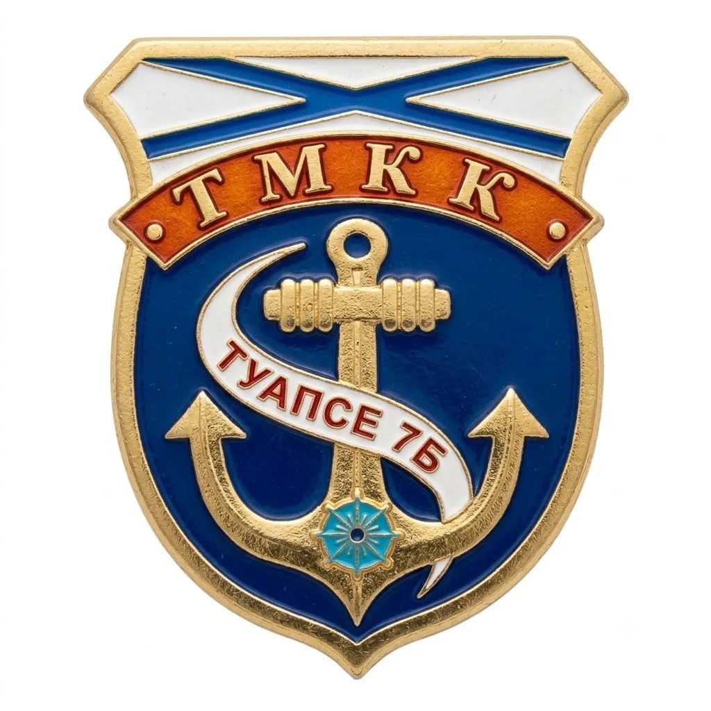

  

  <h1>7 «Б» · 12-я учебная группа</h1>
  
<strong>Туапсинский морской кадетский корпус</strong>

  
Наш класс, наша команда, наша история.

  
  

---

## ⚓ О проекте

Небольшой сайт 7 «Б» — 12-й учебной группы Туапсинского морского кадетского корпуса. Здесь можно познакомиться с классом, узнать о его ценностях и посмотреть достижения кадетов.

> **«Жизнь — Отечеству, честь — никому»**